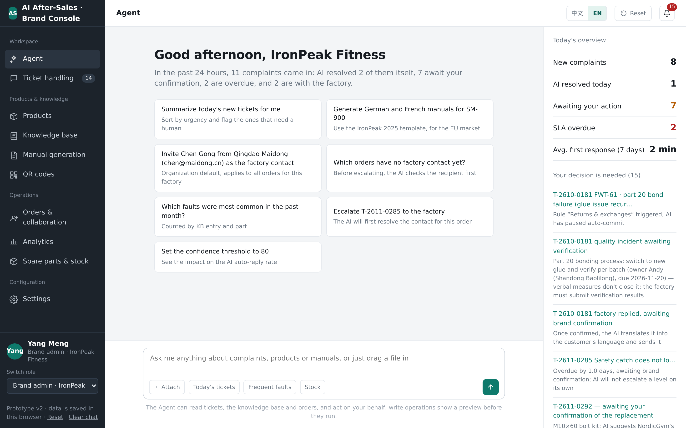
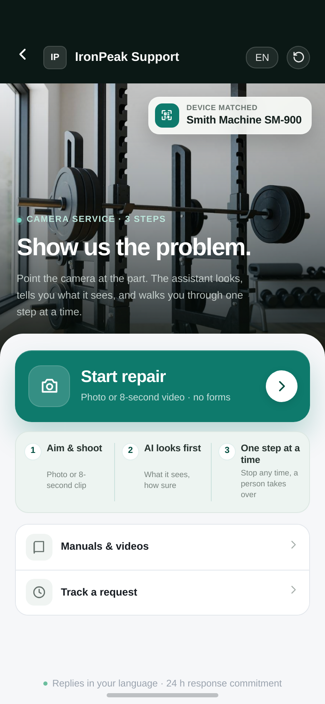
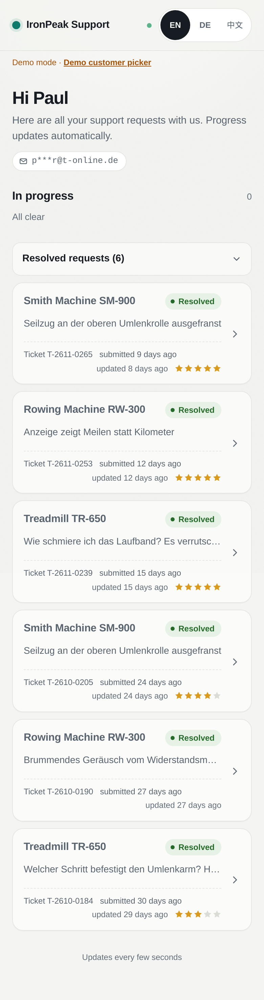

# AI 售后服务平台原型

面向健身器材售后场景的 AI 服务原型，覆盖 **品牌方管理后台、客户扫码 H5、客户工单追踪页** 三个端。三端都是可独立打开的单文件前端，通过同源 `localStorage` 串联演示流程，不依赖后端即可跑通“客户报障 → 工单进入后台 → 客服处理 → 客户查看进度”的完整链路。

> 当前仓库是**交互原型 / 研发交接基线**，不是可直接上线的生产系统。身份认证、服务端数据、对象存储、真实邮件/LLM 调用、权限审计等仍需在正式工程中落地，具体边界见[生产化改造清单](#生产化改造清单)。

## 目录一览

| 端 | 当前产物 | 说明 |
|---|---|---|
| 品牌方管理后台 | [`AI售后/原型_品牌方后台.html`](./AI售后/原型_品牌方后台.html) | 工单、产品、知识库、说明书、二维码、订单协作、分析、备件、系统设置；支持品牌方 / 工厂 / 分销商三种视图 |
| 客户扫码 H5 | [`AI售后/原型_H5扫码端.html`](./AI售后/原型_H5扫码端.html) | 选择语言、识别标签/序列号、拍照或短视频报障、AI 分步诊断、生成工单、查进度、看说明书 |
| 客户追踪页 | [`AI售后/原型_客户追踪页.html`](./AI售后/原型_客户追踪页.html) | 通过客户邮箱与 token 查看工单列表/详情、物流、时间线和实时更新；支持中英德三语 |

<table>
  <tr>
    <td align="center"><br><sub>品牌方管理后台</sub></td>
    <td align="center"><br><sub>客户扫码 H5</sub></td>
    <td align="center"><br><sub>客户追踪页</sub></td>
  </tr>
</table>

## 已实现的核心链路

- **客户报障**：扫码进入 H5，按语言展示界面；识别产品标签与序列号，支持相机拍照、短视频、文字描述和语音入口。
- **AI 诊断**：基于知识条目、置信度、规则与安全件策略生成回复或转人工；支持追问轮数限制、安全风险拦截和寄件承诺规则。
- **工单流转**：H5 生成的工单通过 `as_h5_inbox` 被后台导入，后台可回复、升级工厂、确认补发、标记解决和模拟客户回信。
- **追踪闭环**：后台状态变更会反映到客户追踪页；追踪页每 4 秒刷新一次，并保留滚动位置、展开状态和语言偏好。
- **角色隔离**：后台演示品牌方、工厂、分销商三种角色及对应的数据可见范围。
- **知识库与说明书**：包含知识图谱、术语表、缺口分析、说明书生成向导、合规检查和交付文件流程。
- **批次与二维码**：支持批次一致性检查、二维码生成/下载、扫码归因和转化统计。
- **多语言**：后台支持中英切换；H5 支持多语种报障；追踪页支持中英德切换。

## 快速开始

### 环境要求

- Node.js：建议 `24.15+`（当前验证环境为 `v24.15.0`；`jsdom@30` 对 Node 版本有要求）
- Python：`3.10+`（当前验证环境为 `3.14.6`）
- 现代浏览器：Chrome / Edge / Safari

### 安装依赖并启动

```bash
cd AI售后
(cd src && npm ci)
python3 -m http.server 4173
```

浏览器打开以下地址。**建议用本地 HTTP 服务访问，不要直接双击 HTML**：三端依赖同源 `localStorage` 联动，`file://` 下浏览器可能隔离存储；相机能力在 `localhost` 可用，部署到其他域名时需要 HTTPS。

```text
后台：   http://localhost:4173/原型_品牌方后台.html
H5：     http://localhost:4173/原型_H5扫码端.html?m=TR-650&lang=zh
追踪页： http://localhost:4173/原型_客户追踪页.html?demo=1#/
```

macOS 也可以直接执行：

```bash
open "http://localhost:4173/原型_品牌方后台.html"
open "http://localhost:4173/原型_H5扫码端.html?m=TR-650&lang=zh"
open "http://localhost:4173/原型_客户追踪页.html?demo=1#/"
```

### 推荐演示顺序

1. 打开后台，查看智能体首页、工单和知识库。
2. 打开 H5，选择语言与型号，完成一次拍照/短视频报障。
3. 回到后台的“工单处理”，查看 H5 传入的新工单并回复或升级。
4. 打开追踪页的 demo 选择器，选择客户邮箱，查看列表与详情；也可以等后台状态变化，观察页面自动刷新。
5. 在后台左下角“重置”可恢复种子数据；或在 DevTools 中清除本站 `localStorage`。

## 页面参数

### H5

| 参数 | 取值示例 | 作用 |
|---|---|---|
| `m` | `SM-900` / `TR-650` / `RW-300` | 指定产品型号；未知型号回落到默认产品 |
| `lang` | `en` | 强制英文首屏；不传默认中文 |
| `q` | 二维码记录 ID | 扫码归因，后台统计使用 |
| `b` | `24A` | 二维码携带的批次提示；序列号校验优先 |
| `f` | 工厂/供应商名 | 二维码携带的供应商提示 |
| `go` | `shot` / `chat` / `manual` / `how` 等 | 演示直达指定流程，例如 `?go=shot` 直接打开拍照相机 |
| `demo` | `1` | 在指定流程中注入演示数据 |

### 客户追踪页

| 参数 | 说明 |
|---|---|
| `?e=<email>&k=<token>` | 正式演示入口；`k` 必须是该邮箱对应的原型 token |
| `?demo=1#/` | 打开客户选择器，方便内部演示 |
| `#/t/<ticket-id>` | 直接打开某张工单详情 |

追踪页的 token 由 `track_app.js` 中的确定性哈希生成，只用于原型防误入，**不是生产级鉴权**。

## 构建与源码约定

### 当前源码事实

```text
AI售后/
├── 原型_品牌方后台.html        # 当前后台的唯一事实源（单文件）
├── 原型_H5扫码端.html          # 由 src/ 构建生成
├── 原型_客户追踪页.html        # 由 src/ 构建生成
├── src/
│   ├── h5_head.html            # H5 外壳与样式
│   ├── h5_app.js               # H5 业务逻辑
│   ├── track_head.html         # 追踪页外壳与样式
│   ├── track_app.js            # 追踪页业务逻辑
│   ├── engine.js               # 产品、序列号、知识匹配、回复组合
│   ├── policy.js               # 阈值、安全规则、寄件承诺策略
│   ├── policy.config.json      # 策略出厂值
│   ├── app_state.js            # 后台状态、种子数据、持久化
│   ├── app_pages.js            # 后台页面渲染
│   ├── app_agent.js            # 后台智能体交互
│   ├── kg.js / kg.css          # 知识图谱
│   └── build.py                # H5 / 追踪页构建脚本
├── output/                     # 截图、PPT 用图和 Playwright 验证产物
├── 备份_*/                     # 按日期保留的历史快照
└── *.md                        # 产品、设计、策略与案例分析文档
```

### 构建命令

在 `AI售后/src/` 下执行：

```bash
npm run build         # 构建 H5 + 追踪页
npm run build:h5      # 只构建 H5
npm run build:track   # 只构建追踪页
```

**不要执行 `python3 build.py all`。** 当前 `原型_品牌方后台.html` 在 2026-11-09 之后被直接修改过，`src/head.html`、`app_state.js`、`app_pages.js`、`app_agent.js` 尚未完整回写；`all` 会用旧分片覆盖后台单文件。若必须恢复后台构建链，先做源码回写和全量回归，再解除这条限制。

知识图谱改动使用：

```bash
python3 sync_kg.py
node kgtest.js
```

后台国际化字典和后台单文件的更新请遵循 `src/i18n_*.py`、`src/i18n_dict.js` 及文档中的现有流程。

## 测试与验收

### 一键回归

```bash
cd AI售后/src
npm test
```

`npm test` 当前包含以下稳定测试：

| 测试 | 覆盖范围 | 2026-11-17 基线 |
|---|---|---|
| `policytest.js` | 策略阈值、规则、锁定项、审计 | 52 / 52 |
| `kgtest.js` | 知识图谱数据、节点关系、交互 | 14 / 14 |
| `i18ntest.js` | 后台中英切换、持久化、动态文案 | 全部通过 |
| `h5test.js` | H5 语言、标签、相机、诊断、转人工、追踪 | 全流程通过，无 JS 错误 |
| `tracktest.js` | token、隔离、投影、物流、轮询、XSS、响应式 | 41 / 41 |
| `bridgetest.js` | H5 ↔ 后台工单/库存/寄件联动 | 全部通过 |
| `batchtest.js` | 批次表、二维码、筛选、供应商视图 | 17 / 17 |
| `verify_fwt61.js` | FWT-61 案例回归 | 22 / 22 |

### 已知基线问题

```bash
npm run test:dom
```

当前 `domtest.js` 为 **52 项通过 / 7 项失败**。失败集中在后台单文件与 `src/` 历史不同步导致的旧选择器/视图路径，不是本次新增回归；在完成后台源码回写前，不要把 `domtest.js` 作为全绿门禁。修复后台同步后应把它并入 `npm test`。

国际化残留巡游：

```bash
node i18ncov.js
```

该脚本会在英文模式下走完后台主要页面和弹层，检查可见中文残留。

## 数据与联动方式

当前没有服务端。三端通过以下浏览器存储键联动：

| Key | 写入方 | 用途 |
|---|---|---|
| `as_state` | 后台 | 后台完整演示状态、设置、工单、订单、库存等 |
| `as_h5_inbox` | H5 | H5 提交的报障记录，后台轮询导入 |
| `as_lang` | 后台 | 后台语言偏好 |
| `as_track_lang` | 追踪页 | 追踪页语言偏好 |

因此：

- 必须使用**同一浏览器、同一 origin** 打开后台和 H5。
- 换浏览器、换设备、换端口或换域名后不会共享数据。
- 清除站点数据会回到种子状态。
- 所有客户、订单、邮箱和工单数据均为演示数据，不包含真实个人信息。

## 关键文档

| 文档 | 内容 |
|---|---|
| [`原型v2说明.md`](./AI售后/原型v2说明.md) | 后台、H5、追踪页的完整演示逻辑与已实现边界 |
| [`原型自查报告_2026-11-04.md`](./AI售后/原型自查报告_2026-11-04.md) | 原型自查与历史问题清单 |
| [`设计_客户追踪页_v1.md`](./AI售后/设计_客户追踪页_v1.md) | 追踪页信息架构、状态投影、token 与测试项 |
| [`设计_批次_v1.md`](./AI售后/设计_批次_v1.md) | 批次、二维码、供应商与归因设计 |
| [`政策层使用说明.md`](./AI售后/政策层使用说明.md) | 策略配置、锁定项、审计与规则边界 |
| [`LLM嵌入方案_AI售后.md`](./AI售后/LLM嵌入方案_AI售后.md) | AI 回复、知识检索、成本与风控方案 |
| [`案例分析_FWT-61_平台走单与设计优化.md`](./AI售后/案例分析_FWT-61_平台走单与设计优化.md) | 典型工单链路和产品设计复盘 |
| [`截图对照_中英.md`](./AI售后/截图对照_中英.md) | 中英文界面截图对照 |

产品介绍材料位于 [`AI售后服务平台_客户介绍.pptx`](./AI售后/AI售后服务平台_客户介绍.pptx) 和 [`AI售后服务平台_客户介绍.pdf`](./AI售后/AI售后服务平台_客户介绍.pdf)。

## 开发约定

- 优先修改源码，再生成单文件产物；唯一例外是当前后台单文件，修改前后务必记录同步状态。
- 不把 `node_modules/`、`.playwright-cli/`、Office 锁文件、临时 `.bak` 和第三方服务签名响应提交进仓库。
- 处理后台事件流或异步渲染时，确保 `render()`、`openDrawer()`、`openModal()`、`toast()` 的国际化出口仍然生效。
- 追踪页涉及客户可见内容时，不能把后台内部字段、处理方原因或内部备注直接投影给客户。
- 新增 H5 或追踪页逻辑后，至少运行 `npm test`；修改后台单文件后，额外运行 `node domtest.js` 并对比已知失败集。

## 生产化改造清单

正式研发接手时，建议按以下优先级拆分：

1. **服务端与数据模型**：把 `as_state` / `as_h5_inbox` 替换为数据库、API 和事件流；建立租户、角色、订单、工单、消息、附件、库存、审计等实体。
2. **身份与权限**：接入企业 SSO 或账号体系；品牌方、工厂、分销商按组织与订单范围做服务端鉴权，不能只靠前端菜单隐藏。
3. **追踪链接安全**：用服务端签名 token、过期时间、限流和可撤销机制替换当前确定性哈希；避免在 URL 中直接暴露邮箱。
4. **文件与媒体**：客户照片/视频上传到对象存储，使用短期签名 URL、病毒扫描、大小与格式限制、隐私保留策略。
5. **AI 服务**：LLM、ASR、图像理解全部走服务端；检索知识库、策略判断和工具调用必须服务端执行并留痕，密钥不得进入浏览器。
6. **邮件/ERP/CRM**：落地邮箱接入、工单同步、订单与库存接口、工厂协作通知和失败重试机制。
7. **可观测性与合规**：补充结构化日志、SLA 告警、调用链追踪、审计导出、数据脱敏、保留期限和客户删除流程。
8. **质量门禁**：把现有 jsdom 回归迁移为单元/集成测试，增加 Playwright 端到端、真机 H5、可访问性与多语种验收。

## 仓库说明

- GitHub：`https://github.com/aero323/ai-after-sales-platform`
- 默认分支：`main`
- 仓库性质：私有仓库（如需公开请由仓库所有者显式调整）
- 历史快照：`备份_*` 目录用于原型回滚和追溯，保留日期与变更前状态；不要把备份目录当作正式源码入口。
